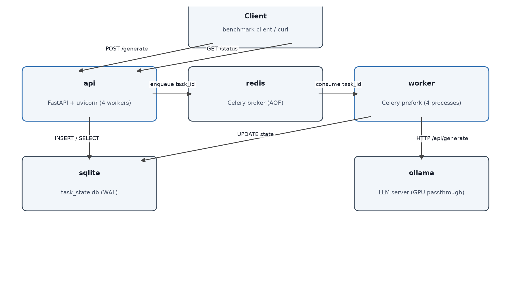
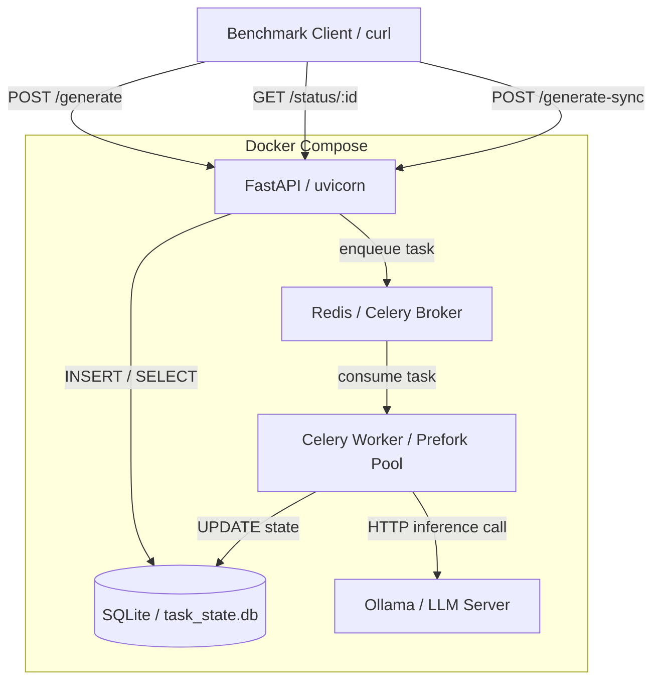

# Async LLM API Gateway

FastAPI, Celery, Redis, SQLite

**Problem:** When an API runs LLM inference inside the request, each request holds a server thread until the model finishes. Under load the server runs out of threads and clients start seeing timeouts.

**Approach:** The API saves each request, puts it on a Redis-backed Celery queue and returns straight away. Background workers run the model and write the result back, and the client polls for it.

**What's here:** The API returns `202` after one SQLite insert and a queue push, without waiting for inference. A synchronous endpoint is kept as a baseline, and a benchmark client ramps from 10 to 500 concurrent requests against both and records drop rate, P50/P95/P99 latency and throughput (see Benchmarking).

---

## Overview

This repository implements a containerized asynchronous gateway for LLM inference. It separates accepting a request from running the model. A client submits a prompt and gets a `task_id` back immediately. Background workers run the inference and save the result to SQLite. The client polls a status endpoint until the task reaches a final state.

The gateway runs as four containers. FastAPI accepts HTTP requests. Redis carries task IDs from the API to a Celery worker pool. SQLite stores the task state. Ollama (or a mock backend that sleeps for a random interval) runs the model call.

A synchronous baseline endpoint ships in the same container image. It runs the model inside the request, on the API's thread pool. Note that the two paths do not have the same capacity: the async path is limited to 4 Celery worker processes, while the sync path can use every thread in the API's thread pools. Keep that in mind when reading benchmark results.

Every state change is guarded by the task's current status, so races between workers and timeouts turn into no-ops instead of overwriting each other. Known limitations are listed at the end of the Architecture decisions section.

---

## Architecture





### Request lifecycle

1. Client posts a prompt to `POST /generate`.
2. The API validates the body, inserts a `QUEUED` row into SQLite, then pushes the `task_id` onto the Redis queue. The insert always happens before the push, so any task that exists in the queue also exists in SQLite.
3. A prefork worker pops the `task_id` and claims it with an atomic update: `UPDATE tasks SET status='PROCESSING' WHERE task_id=? AND status='QUEUED'`. A zero-row result means the task was already claimed or has expired, so the worker stops without calling the model.
4. The worker calls the backend (mock sleep, or Ollama over HTTP) and writes the result: `UPDATE tasks SET status='SUCCESS' ... WHERE task_id=? AND status='PROCESSING'`. A zero-row result means the API already marked the task `TIMEOUT`, and the result is dropped.
5. The client polls `GET /status/{task_id}` until it sees `SUCCESS`, `FAILURE` or `TIMEOUT`.

SQLite is the source of truth. Redis is only the queue (with AOF persistence), not a state store. Celery runs without a result backend; every state change is an explicit SQL write.

---

## Prerequisites

- Docker 20.10 or newer, with Docker Compose v2
- 4 GB free RAM for the default stack
- Optional: an NVIDIA GPU with `nvidia-container-toolkit` installed for GPU-accelerated Ollama inference
- Optional: Python 3.11+ with `httpx` (and `matplotlib` for the graph) for running the benchmark from the host

The default `MOCK_MODE=true` stack needs no GPU and no model download. The Ollama container still starts, because the worker waits for it to be healthy. First-run Docker image pulls need network access.

---

## Quick start

On a machine without an NVIDIA GPU, first comment out the `runtime: nvidia` line in `docker-compose.yml` (see GPU passthrough).

```bash
docker compose up --build
```

The API is reachable at `http://localhost:8000` once the services report healthy. Verify:

```bash
curl http://localhost:8000/health
# {"status":"ok","redis":"connected","db":"connected"}
```

Submit an async request:

```bash
curl -X POST http://localhost:8000/generate \
  -H "Content-Type: application/json" \
  -d '{"prompt":"Explain quantum computing in one paragraph"}'
# 202 {"task_id":"<uuid>","status_url":"/status/<uuid>"}
```

Poll the status endpoint every 200-500 ms. The mock backend sleeps 2-6 seconds before completing:

```bash
curl http://localhost:8000/status/<task_id>
# {"status":"QUEUED"}   (initial)
# {"status":"SUCCESS","result":{"generated_text":"This is a canned mock response.","total_time_ms":4213,...}}
```

---

## API reference

| Endpoint | Method | Description | Key response |
| --- | --- | --- | --- |
| `/generate` | POST | Submit an async LLM request | `202` with `task_id` and `status_url` |
| `/status/{task_id}` | GET | Poll task state | `200` with status and, on success, the result |
| `/generate-sync` | POST | Synchronous baseline (blocks) | `200` with the result, or `503` on backend failure |
| `/health` | GET | Infrastructure status | `200` with `redis` and `db` connection state |

### POST /generate

```bash
curl -X POST http://localhost:8000/generate \
  -H "Content-Type: application/json" \
  -d '{"prompt":"Explain quantum computing","temperature":0.7,"max_tokens":256,"model":"tinyllama"}'
```

Validation failures return `422`. An unreachable task database returns `503`. If Redis is down the request does not fail: the row is inserted, the enqueue is skipped with a logged warning, and the API still returns `202`. The task stays `QUEUED` until it times out.

### GET /status/{task_id}

```bash
curl http://localhost:8000/status/<task_id>
```

| Status | Meaning |
| --- | --- |
| `QUEUED` | Inserted, waiting in the queue |
| `PROCESSING` | A worker claimed it and is running inference |
| `SUCCESS` | Done; `result` carries `generated_text`, `total_time_ms`, `tokens_generated`, `tokens_per_second` |
| `FAILURE` | Backend error; `error` holds the message, `retryable` says whether resubmitting is safe |
| `TIMEOUT` | Exceeded `TASK_TTL` while `QUEUED` or `PROCESSING`; final |

Unknown `task_id` returns `404`.

### POST /generate-sync

```bash
curl -X POST http://localhost:8000/generate-sync \
  -H "Content-Type: application/json" \
  -d '{"prompt":"Hello"}'
```

This endpoint blocks until inference completes and exists only as the benchmark baseline. It returns `503` on backend failure. When all threads are busy, new requests wait for a free thread, and requests that wait too long show up as client timeouts, which the benchmark counts as failures.

---

## Client guidance

- Poll `GET /status/{task_id}` every 200-500 ms. Faster polling adds read load on SQLite without lowering latency.
- The benchmark treats a task as failed if it hasn't finished within 120 seconds (`--timeout`).
- Tasks still `QUEUED` or `PROCESSING` after `TASK_TTL` (default 300 s, counted from creation) are marked `TIMEOUT` on the next poll. The row itself is updated, so a late worker result cannot bring the task back.
- On `FAILURE`, check `retryable`. Resubmit only when it is `true`.

---

## Benchmarking

The benchmark sends ramped concurrent requests to one endpoint per run and writes results to a JSON file after each concurrency level, so a crash mid-run keeps every completed level.

### Prerequisites

```bash
pip install httpx matplotlib
```

### Async run

```bash
python benchmark/run.py --mode async --concurrency 10 50 100 200 500 --output benchmark/results_async.json
```

### Sync baseline run

```bash
python benchmark/run.py --mode sync --concurrency 10 50 100 200 500 --output benchmark/results_sync.json
```

Pass `--output` on both runs. The default output file is the same for both modes, so without it the second run overwrites the first.

### Flags

| Flag | Default | Meaning |
| --- | --- | --- |
| `--target` | `http://localhost:8000` | Base URL of the gateway |
| `--concurrency` | `10 50 100 200 500` | Concurrency levels, run in order |
| `--mode` | required | `async` or `sync` |
| `--output` | `benchmark/results.json` | Results file (written after each level) |
| `--poll-interval` | `200` | ms between status polls |
| `--timeout` | `120` | seconds before a task counts as failed |

### Graph

```bash
python benchmark/plot.py
```

This reads `benchmark/results_async.json` and `benchmark/results_sync.json` and produces `benchmark/benchmark_results.png` (1200 x 800, 150 DPI): drop rate on top and P99 latency below, async in blue circles (dashed) and sync in red squares (solid). If one results file is missing, the available series still renders; if both are missing, the script exits with instructions.

### Reading the results

- In mock mode each task takes 2-6 s and the async path has 4 workers, so it completes roughly one task per second. At high concurrency, tasks near the back of the queue can pass the 120 s client timeout and count as dropped even though the API accepted them.
- The sync path runs on the API's thread pools, which hold more requests at once than 4 workers, so it may complete more requests in mock mode.
- The async path's main difference is how fast requests are accepted. That is recorded per level as `p99_post_response_time_ms` in the async results file; it is not plotted.

> **Status:** benchmark results are not committed yet.

---

## Mock vs Ollama mode

| Setting | Behavior |
| --- | --- |
| `MOCK_MODE=true` (default) | Worker sleeps a random 2-6 s and returns canned text. No GPU, no model download. |
| `MOCK_MODE=false` | Worker connects to Ollama at `OLLAMA_URL`. On first use it checks `/api/tags`, pulls `DEFAULT_MODEL` if missing (with progress logs), then runs inference through the HTTP API. |

`MOCK_FAILURE_RATE` (0.0-1.0) makes the mock backend raise `LLMBackendError("Simulated OOM")` with that probability, which exercises the `FAILURE` path and the `retryable` flag.

---

## GPU passthrough

The Ollama container uses `runtime: nvidia` in `docker-compose.yml`. This requires `nvidia-container-toolkit` on the host. Without it, Docker rejects the compose file.

On a CPU-only host, comment out the `runtime: nvidia` line (the compose file has a note) or use a compose override. Ollama then runs on CPU: slower, but it works.

`deploy.resources` is not used because `docker compose up` ignores it outside Swarm, and `NVIDIA_VISIBLE_DEVICES` is the older `nvidia-docker2` approach. `runtime: nvidia` is enough on its own.

Verify with:

```bash
docker compose exec ollama nvidia-smi
```

---

## Environment variables

| Variable | Default | Description |
| --- | --- | --- |
| `REDIS_URL` | `redis://redis:6379/0` | Celery broker URL |
| `DB_PATH` | `/data/task_state.db` | SQLite file path |
| `OLLAMA_URL` | `http://ollama:11434` | Ollama HTTP API base |
| `MOCK_MODE` | `true` | Use the mock backend (no GPU needed) |
| `MOCK_FAILURE_RATE` | `0.0` | Probability the mock backend raises a simulated failure |
| `TASK_TTL` | `300` | Seconds after creation before an unfinished task is marked `TIMEOUT` |
| `VALID_MODELS` | `tinyllama,llama3,llama3:8b` | Allowlist checked by the API when `MOCK_MODE=false` |
| `DEFAULT_MODEL` | `tinyllama` | Model pulled on first Ollama startup, and used when a request doesn't name one |
| `MODEL_PULL_TIMEOUT` | `600` | Max seconds to wait for a model download |
| `LOG_LEVEL` | `info` | Logging verbosity |

---

## Architecture decisions

**SQLite with WAL mode for task state.** No extra service, one file, shared between containers through a Docker volume. WAL allows concurrent readers with one writer at a time. `busy_timeout=5000` waits out short contention, and a retry wrapper (5 attempts, 100 ms to 1.6 s backoff) handles the rest. The API uses `aiosqlite` so database calls don't block the event loop; the prefork workers use plain `sqlite3`.

**Redis as the Celery broker, not a state store.** The queue runs with AOF persistence (`--appendonly yes --appendfsync everysec`) so queued messages survive a Redis restart. Task state lives only in SQLite, and Celery's result backend is disabled.

**Prefork worker pool.** Four worker processes, each handling one task at a time with its own SQLite connection. The model itself runs in Ollama, so a worker mostly waits on an HTTP call. Prefork processes have no event loop by default, which is why the backend interface is synchronous. Async throughput is therefore capped at 4 tasks in flight.

**Insert before push.** The SQLite insert always happens before the Redis push. If the push fails, the task stays `QUEUED`, the client still gets `202`, and the task is marked `TIMEOUT` once `TASK_TTL` passes.

**Status-guarded updates for every state change.** Each update checks the current status (`WHERE status='QUEUED'`, `WHERE status='PROCESSING'`, `WHERE status IN ('QUEUED','PROCESSING')`) and checks `rowcount`, so races become no-ops. There are no external locks and no background cleanup job; timeouts are applied when a client polls.

**Sync baseline on the same image.** `POST /generate-sync` runs the model call on the API's default thread pool (`run_in_executor`) and holds that thread for the full inference. When every thread is busy, new requests wait. That behavior is what the baseline is there to measure.

**Known limitations**

- **Worker crash mid-task.** Tasks use `acks_late=True`, so a task is redelivered if its worker dies. But the claim only succeeds on `QUEUED` rows, and a crashed task is already `PROCESSING`, so the redelivered task is skipped. The task stays `PROCESSING` until `TASK_TTL` passes and is then marked `TIMEOUT`. It is not re-run.
- **Enqueue blocks the event loop briefly.** `send_task` is a synchronous call inside the async endpoint. It is normally fast, but when Redis is unreachable it can block the event loop while Celery's publish retries run.
- **A new SQLite connection per request.** Each request opens a connection and re-runs the schema and WAL checks. It's simple but adds overhead.
- **SQLite write throughput.** WAL allows one writer at a time, so many simultaneous writes queue behind that lock. Production use would need Postgres or a dedicated state store.

---

## Repository layout

```
├── api/            FastAPI app: routes, models, error handlers, producer Celery app
├── worker/         Celery app, run_inference task, LLM backends (base/mock/ollama)
├── common/         Shared SQLite layer (sync + async), JSON logging
├── benchmark/      run.py (load driver), plot.py (dual-panel graph)
├── tests/          API tests (no Docker) + integration suite (Docker, auto-skipped)
├── docs/           Architecture diagram
└── docker-compose.yml, Dockerfile, .env.example
```

## Verification

These run without Docker:

```bash
python -m pytest tests/ -q          # 5 API tests pass, 7 Docker tests skip
python test_db_init.py              # schema, WAL, busy_timeout, retry wrapper
python test_concurrent_inserts.py   # 750 inserts in batches of 50, 200 and 500 concurrent threads, zero lock errors
```

The Docker integration suite (happy path, worker failure, Redis down, 404, 422, idle expiry, timeout race) runs with `pytest tests/test_integration.py` on a host with Docker, and skips without it.
